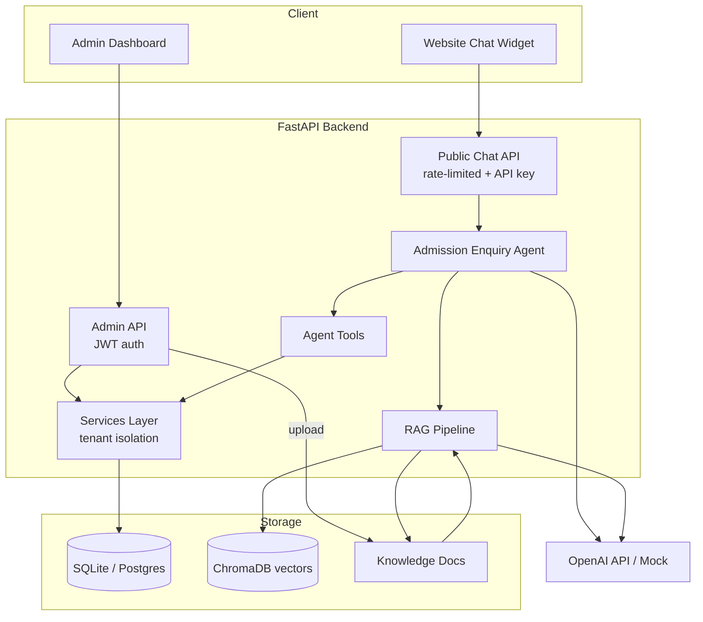

# BizAssist — AI-Powered Admission Enquiry Agent for Coaching Centres

> **Status: v1.0 (initial final version).** All 10 build phases complete,
> multi-tenant, multi-provider LLM (Ollama default), **126 tests passing**.
> A detailed block-diagram design doc lives in `ARCHITECTURE.md`.

BizAssist is a multi-tenant SaaS MVP that gives coaching centres an
AI admission-enquiry assistant. Prospective students chat through an
embeddable website widget; the AI answers questions about courses, fees,
batches, eligibility and admissions using **Retrieval-Augmented Generation
(RAG)** grounded in each institute's own documents, registers enquiries as
leads, and escalates to human counsellors when needed. Staff manage
everything from an admin dashboard.

## Key capabilities

- Grounded Q&A over institute documents (PDF / DOCX / TXT) via RAG + ChromaDB
- Intent understanding and a tool-using admission enquiry agent
- Lead capture, follow-up scheduling, and human escalation
- Conversation sessions with memory of details already provided
- Multi-tenant isolation — every institute's data is separated
- Admin dashboard: stats, leads, conversations, documents, courses/fees
- **Pluggable LLM providers** — Ollama (local, default), Anthropic Claude,
  OpenAI, Groq, OpenRouter, or a zero-cost deterministic mock

## Technology

FastAPI · Pydantic · SQLAlchemy · SQLite (Postgres-ready) · LangChain ·
ChromaDB · Bootstrap 5 · Docker · LLMs: Ollama / Claude / OpenAI / Groq /
OpenRouter (pluggable)

## Architecture



## Project structure

```
bizassist/
  app/
    main.py            # FastAPI app factory
    api/               # Routers (public chat + admin)
    agents/            # Admission enquiry agent
    tools/             # Agent tools (structured I/O)
    rag/               # Ingestion + retrieval pipeline
    models/            # SQLAlchemy ORM models
    schemas/           # Pydantic schemas
    services/          # Tenant-isolated business logic
    database/          # Engine + session
    auth/              # Hashing, JWT, dependencies
    config/            # Settings + logging
    templates/         # Jinja2 (dashboard + widget demo)
    static/            # CSS/JS (widget, dashboard)
  knowledge_base/      # Seed + uploaded documents
  sample_data/         # Seed definitions
  tests/               # Pytest suite (mock LLM)
  scripts/             # Seed / utility scripts
  requirements.txt
  .env.example
  Dockerfile
  docker-compose.yml
```

## Quick start

```bash
python -m venv .venv
# Windows:
.venv\Scripts\activate
# macOS/Linux:
source .venv/bin/activate

pip install -r requirements.txt
cp .env.example .env            # Windows: copy .env.example .env

# Seed the demo institutes (SGEN Computer Academy + Bright Career) + admins
python -m scripts.seed

# Build the RAG vector index from the institute's documents
python -m scripts.ingest

# Run
uvicorn app.main:app --reload
```

Then open:
- Widget demo (student view): http://localhost:8000/
- Admin dashboard: http://localhost:8000/admin
- API docs (Swagger): http://localhost:8000/docs

**Two demo institutes are seeded** (fully isolated from each other):

| Institute | Admin login | Public widget key | Courses |
|---|---|---|---|
| SGEN Computer Academy | `admin@sgenacademy.example` / `admin12345` | `demo-sgen-academy-key` | Python, Java, Full Stack, Data Analytics |
| Bright Career Institute | `admin@brightcareer.example` / `admin12345` | `demo-bright-career-key` | Banking, SSC, Railway, Aptitude |

On the demo page (`/`) a switcher lets you flip between the two institutes'
widgets; or open `/?institute=bright-career-institute` directly.

> **Multi-tenant routing:** the public chat resolves the institute from the
> `X-Institute-Key` header. When more than one institute is active, the key is
> **required** (a keyless request returns 400 so it can never hit the wrong
> tenant). With a single institute it falls back to that one for convenience.

> **Windows (PowerShell):** activate the venv with `.venv\Scripts\Activate.ps1`,
> and copy the env file with `Copy-Item .env.example .env`. The project was
> verified on Python 3.12.

## LLM providers

The chat model is pluggable via `LLM_PROVIDER` in `.env`:

| Provider | Needs a key? | Notes |
|---|---|---|
| `ollama` **(default)** | No | Local, private, free. Install [Ollama](https://ollama.com/download), run it, and `ollama pull llama3.1`. |
| `anthropic` | Yes | Claude via the native SDK. Set `ANTHROPIC_API_KEY` + a model your account can access (e.g. `claude-sonnet-5-5`). |
| `openai` | Yes | `OPENAI_API_KEY` + `OPENAI_MODEL`. |
| `groq` | Yes | OpenAI-compatible, fast, free tier. |
| `openrouter` | Yes | OpenAI-compatible gateway to many models (incl. GPT-class). |
| `mock` | No | Deterministic offline responder. Used by the test suite. |
| `auto` | — | Picks the first provider with a key (`groq → openai → anthropic → openrouter`), else the mock. |

How it resolves:
- `USE_MOCK_LLM=true` forces the mock regardless of provider.
- An explicit provider with no usable key safely falls back to the mock, so
  the app always runs.
- **Embeddings** follow `EMBEDDING_PROVIDER` (`auto | openai | ollama |
  hashing`). `auto` uses the chat provider's embeddings when it has them
  (OpenAI, or Ollama with an embed model pulled), otherwise the local hashing
  embedder. The default `.env` uses `hashing` so RAG works offline without
  pulling an extra model.

Examples:
```bash
# Local (default) — no keys, llama3.1 via Ollama
LLM_PROVIDER=ollama

# Anthropic Claude
LLM_PROVIDER=anthropic
ANTHROPIC_API_KEY=sk-ant-...
ANTHROPIC_MODEL=claude-sonnet-5-5

# To use Ollama embeddings too: `ollama pull nomic-embed-text` then
EMBEDDING_PROVIDER=auto
```

> Only keyless-real providers are **Ollama** (local) and the **mock**.
> OpenAI/Groq/OpenRouter/Anthropic require your own key for real calls.

## Run with Docker

```bash
docker compose up --build
```

This builds the image, seeds the demo data, ingests the knowledge base, and
serves the app on http://localhost:8000. A named volume (`bizassist_data`)
persists the SQLite database, the Chroma vector store, and uploaded documents.

Inside the container the LLM defaults to the **mock** (fully offline, no
external services). Select a provider by passing env vars (via your shell or a
`.env` file that `docker compose` reads), e.g.:

```bash
# Hosted model
LLM_PROVIDER=anthropic ANTHROPIC_API_KEY=sk-ant-... docker compose up --build

# Use an Ollama running on the HOST machine
LLM_PROVIDER=ollama \
OLLAMA_BASE_URL=http://host.docker.internal:11434/v1 \
docker compose up --build
```

The compose file maps `host.docker.internal` so the container can reach a
host-run Ollama on Linux too. Also set `SECRET_KEY` and `CORS_ALLOW_ORIGINS`
for a real deployment.

## Testing

```bash
pytest
```

**126 tests pass.** The suite is fully offline and deterministic — it forces
the mock LLM and local hashing embedder, so it never consumes API credits.

| Area | File |
|---|---|
| Course info / fees / batches APIs | `tests/test_courses_api.py` |
| Lead creation, status, follow-ups | `tests/test_leads_api.py` |
| Agent tools, intent, missing-info, escalation, history | `tests/test_chat_agent.py` |
| RAG ingest/retrieve, idempotency, chunking, embeddings, sanitisation | `tests/test_rag.py` |
| Document loaders (TXT/MD/DOCX/unsupported) | `tests/test_loaders.py` |
| Tenant isolation (API + service layer + RAG) | `tests/test_tenant_isolation.py` |
| Admin auth/authz, course CRUD, document upload, embed info | `tests/test_auth_admin.py` |
| Per-tab dashboard + stat-card counts | `tests/test_admin_dashboard_tabs.py` |
| Follow-up transitions, admin follow-ups + conversations | `tests/test_followups_conversations.py` |
| Password hashing + JWT (roundtrip / expiry / tamper) | `tests/test_security.py` |
| LLM provider resolution + client construction | `tests/test_llm_providers.py` |
| Env-driven chat/RAG size limits | `tests/test_config_limits.py` |
| Public chat rate limiting | `tests/test_rate_limit.py` |

## Security posture

Implemented in the application:
- Secrets (DB URL, JWT secret, OpenAI key) are read from the environment; none
  are hard-coded, and no secret or model key is exposed to the browser (the
  widget only uses the **public** institute key).
- Passwords are bcrypt-hashed; admin auth is JWT (bearer header or HTTP-only
  cookie).
- **Tenant isolation** is enforced in the service layer — every query is
  filtered by `institute_id`, and the public chat resolves the tenant from an
  API key, never from client-supplied IDs.
- Request validation via Pydantic (phone/email formats, message length).
- **Prompt-injection defence**: uploaded and retrieved document text is
  sanitised (instruction-override phrases + hidden control characters removed),
  and the agent is instructed to treat that text as data, never instructions.
- Uploads are restricted by extension allowlist and a 10 MB size cap.
- Public chat is rate-limited per client IP.

Deployment responsibilities (not faked in app code): TLS termination,
encryption at rest, a real secrets manager, DPDP/GDPR consent + deletion
workflows, and log retention/RBAC. Tighten `CORS_ALLOW_ORIGINS` from `*` to
your institute domains in production.

## Honest scope notes

- **Multi-tenant.** Two demo institutes are seeded, each with isolated courses,
  documents, leads and admin. Isolation is enforced in the service layer
  (`institute_id` on every table and every query) and in the vector store
  (metadata-filtered). Adding more institutes is just another entry in
  `sample_data/institutes.py` (or an admin-provisioning flow later).
- **Local Ollama by default; mock in tests.** Out of the box the agent uses a
  local Ollama model (free, private), and the test suite forces the
  deterministic mock so it never spends credits. The default embedder is the
  local hashing one, which is lexical — RAG recall on synonym-heavy queries is
  weaker than a real embedding model. Switching to OpenAI/Ollama embeddings
  (`EMBEDDING_PROVIDER`) upgrades retrieval with no code change.
- **Intent routing is deterministic** (keyword-based) for predictable, testable
  behaviour; the LLM handles final wording.
- The in-memory rate limiter suits a single-process deployment; use Redis for
  multi-instance.
